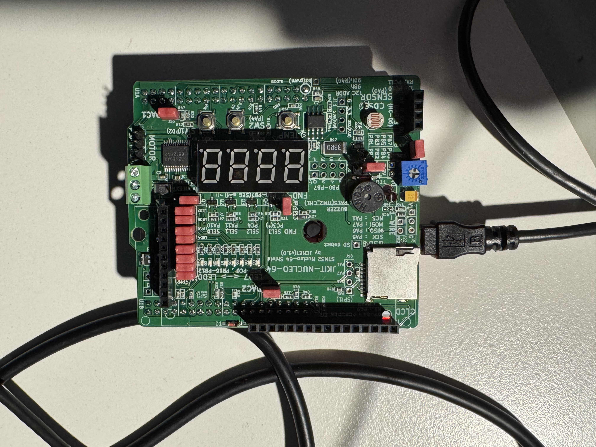
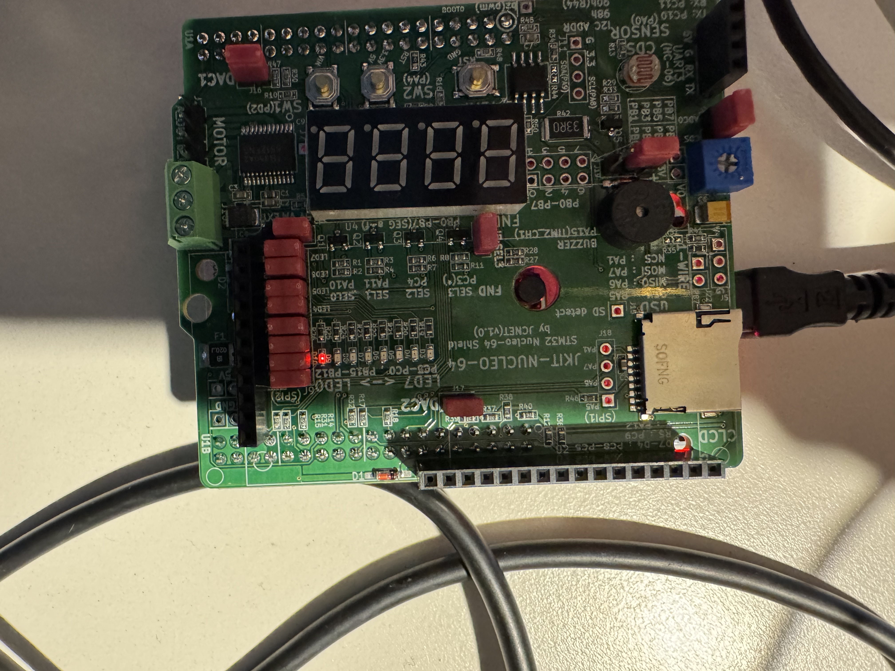
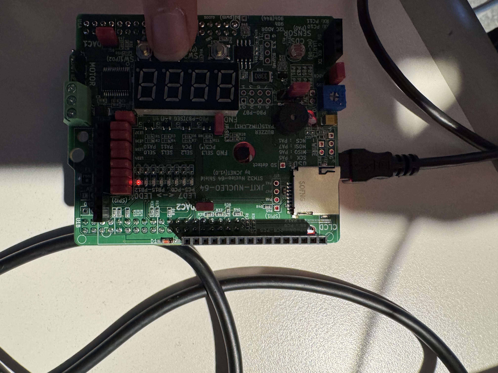
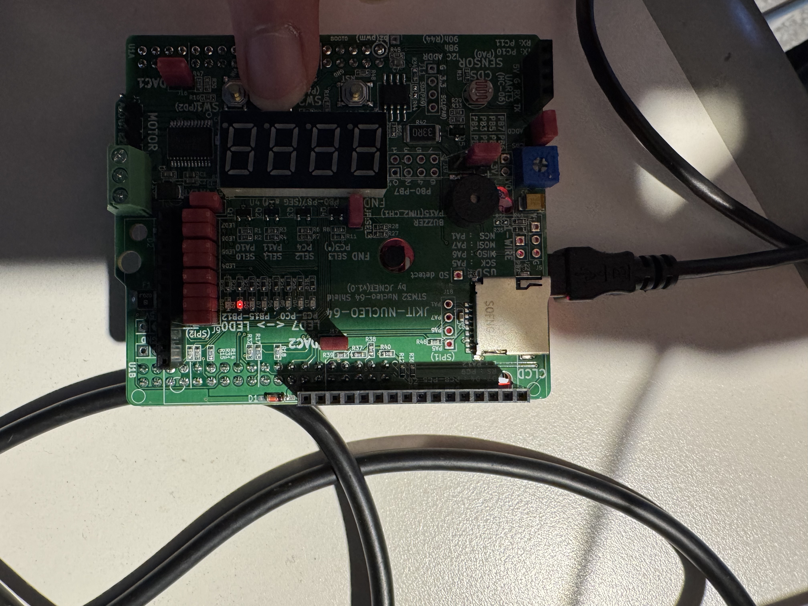
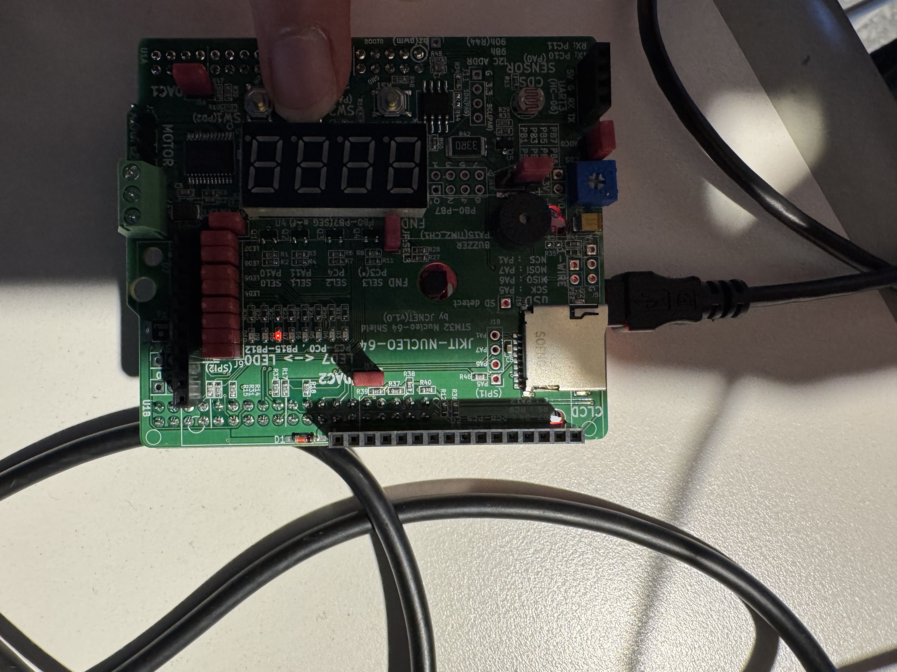
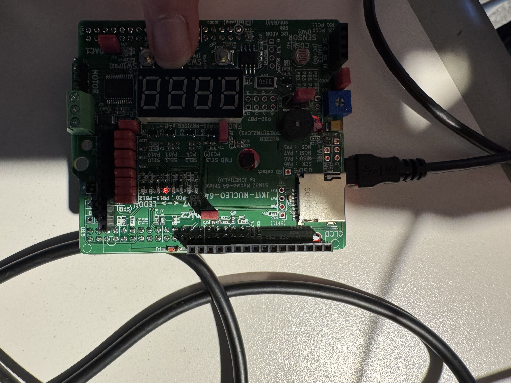
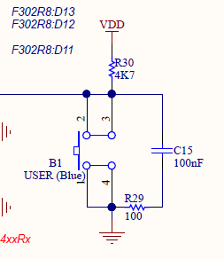

# LAB_GPIO_INOUT_22100510_LeeSeonyu

# LAB: GPIO Digital InOut(eval board)

## LAB: GPIO Digital InOut

**Date:** 2026-09-21

**Author/Partner:** Lee Seonyu

**Demo Video:** 

Problem2: https://youtube.com/shorts/qGCAP_4pIzA?feature=share

Problem3: https://youtube.com/shorts/kIS9NsuzAGQ?feature=share

**PDF version:** 

## Introduction

In this lab, you are required to create a simple program that toggles multiple LEDs using a push-button input.

You must create your own drivers for GPIO digital input and output control.

You must submit

- LAB Report (*.pdf)
- Zip source files(*main*.c, ecRCC.h, ecGPIO.h etc…).
    - Only the source files.
    - Do not submit project files

### Requirement

#### Hardware

- MCU
    - NUCLEO-F411RE
- Eval Board
- Actuator/Sensor/Others:

#### Software

- PlatformIO, CMSIS, EC_HAL library

---

## Problem 0: STM-Arduino

We are going to create a simple program that turns LED(LD2) on and off by pressing the user button(BT1), using Arduino Syntax

### GPIO Digital In/Out

Create a new project under the directory `\repos\EC\lab\`

- The project folder name is “**_GPIO_DIO_LED”.**

Configures the specified pin to behave either as an input or an output.

```cpp
pinMode(pin, mode)
```

- pin: the pin number to set the model of.
- mode: INPUT, OUTPUT or INPUT_PULLUP.

> Look up for pinMode() function in arduino reference for detail description.
> 

### Example code

Open *Arduino IDE* and Create a new program named as ‘**TU_arduino_GPIO_LED_button.ino**’.

Write the following source code: [source code](https://github.com/ykkimhgu/EC-student/tree/main/stm32duino-tutorial).

```cpp
const int btnPin = 3;
const int ledPin = 13;

int btnState = HIGH;

void setup() {
  pinMode(ledPin, OUTPUT);
  pinMode(btnPin, INPUT);
}

void loop() {
  btnState = digitalRead(btnPin);

  if (btnState == HIGH)
    digitalWrite(ledPin, LOW);

  else
    digitalWrite(ledPin, HIGH);

}
```

The user button pin is `PC13`, but this pin cannot be used in arduino. So, you should connect `PC13` to `pinName` `D3` by using wire.

button pin connection


button pin connection

Click on **upload** button. Push the reset button(black) and check the performance.

The LED(LD2) should be turned on when the button is pressed.

---

## Problem 1: Create EC_HAL library

### Procedure

#### **Prepare Library Files**

Manage your library in the directory of `\repos\EC\include\`.

> DO NOT make duplicates of library files under each project folders
> 
- **For VS.Code User:** Save your header library files in this directory. [See here for detail.](/ec/ec-course/tutorial/tutorial-platformio-in-vscode.md)
- **For uVision User:** Save your header library files in this directory. [See here for detail.](https://ykkim.gitbook.io/ec/uvision/adding-my-api-header-in-uvision)

[Download library files.](https://github.com/ykkimhgu/EC-student/tree/main/include/lib-student)

- `ecRCC2.h, ecRCC2.c`
- `ecPinNames.h, ecPinNames.c`
- `ecGPIO2_student.h, ecGPIO2_student.c`

Create your own library for GPIO by renaming the downloaded files (`ecGPIO2_student.*)` as

- `ecGPIO2.c`, `ecGPIO2.h`
- Open `ecGPIO2.c` and change from `#include "ecGPIO2_student.h"` to `#include "ecGPIO2.h"`
- Write your name and modified date in the comment section

> You MUST write your name inside the comment section.
> 

#### Function Definitions

Fill-in the blanks in the header files to complete the definitions for the provided functions

**ecGPIO2.h**

```cpp
void GPIO_init(PinName_t pinName, int mode);
void GPIO_write(PinName_t pinName, int Output);
uint32_t  GPIO_read(PinName_t pinName);
void GPIO_mode(PinName_t pinName, int mode);
void GPIO_ospeed(PinName_t pinName, int speed);
void GPIO_otype(PinName_t pinName, int type);
void GPIO_pupd(PinName_t pinName, int pupd);
```

- Example code in **ecGPIO2.c**

```cpp
// Input(00), Output(01), AlterFunc(10), Analog(11, reset)
void GPIO_mode(PinName_t pinName, uint32_t mode){
    GPIO_TypeDef *port;
    unsigned int pin;
    ecPinmap(pinName, &port, &pin);

    port->MODER &= ~(3UL<<(2*pin));
    port->MODER |= mode<<(2*pin);
}
```

### **Code**

#### GPIO_init

```c
void GPIO_init(PinName_t pinName, uint32_t mode){     
	GPIO_TypeDef * Port;
	unsigned int pin;
	ecPinmap(pinName, &Port, &pin);
	
	// mode  : Input(0), Output(1), AlterFunc(2), Analog(3)   
	if (Port == GPIOA)
		RCC_GPIOA_enable();
	if (Port == GPIOB)
		RCC_GPIOB_enable();
	if (Port == GPIOC)
		RCC_GPIOC_enable();
	if (Port == GPIOD)
		RCC_GPIOD_enable();
	if (Port == GPIOE)
		RCC_GPIOE_enable();
	if (Port == GPIOH)
		RCC_GPIOH_enable();

	GPIO_mode(pinName, mode);
}
```

#### GPIO_mode

```c
void GPIO_mode(PinName_t pinName, uint32_t mode){
   GPIO_TypeDef * Port;
   unsigned int pin;
   ecPinmap(pinName,&Port,&pin);

   Port->MODER &= ~(3UL<<(2*pin));     
   Port->MODER |= mode<<(2*pin);    
}
```

#### GPIO_ospeed

```c
void GPIO_ospeed(PinName_t pinName, uint32_t speed){
	GPIO_TypeDef * Port;
	unsigned int pin;
	ecPinmap(pinName,&Port,&pin);

	Port->OSPEEDR &= ~(3UL<<(2*pin));
	Port->OSPEEDR |= speed<<(2*pin);

}
```

#### GPIO_otype

```c
void GPIO_otype(PinName_t pinName, uint32_t type){
	GPIO_TypeDef * Port;
	unsigned int pin;
	ecPinmap(pinName,&Port,&pin);

	Port->OTYPER &= ~(1UL<<pin);
	Port->OTYPER |= type<<pin;
}
```

#### GPIO_pupd

```c
void GPIO_pupd(PinName_t pinName, uint32_t pupd){
	GPIO_TypeDef * Port;
	unsigned int pin;
	ecPinmap(pinName,&Port,&pin);

	Port->PUPDR &= ~(3UL<<(2*pin));
	Port->PUPDR |= pupd<<(2*pin);

}
```

#### GPIO_write

```c
void GPIO_write(PinName_t pinName, uint32_t Output){
	GPIO_TypeDef *Port;
	unsigned int pin;
	ecPinmap(pinName, &Port, &pin);

	Port->ODR &= ~(1UL<<pin);
	Port->ODR |= Output<<pin;

}
```

#### GPIO_read

```c
uint32_t GPIO_read(PinName_t pinName){
	GPIO_TypeDef * Port;
	unsigned int pin;
	ecPinmap(pinName,&Port,&pin);

	uint32_t btVal = 0;

	btVal = (Port->IDR >> pin) & 1UL;

	return btVal; 
}

```

### Code Description

Since these operations are frequently used in GPIO control, they were implemented as separate functions.

`GPIO_init()` was designed to enable the GPIO peripheral corresponding to the input pin and configure the pin according to the specified mode.

In `GPIO_mode()`, `GPIO_ospeed()`, `GPIO_otype()`, `GPIO_pupd()`, and `GPIO_write()`, the corresponding register bits are first cleared. Then, the input configuration value is shifted to the proper bit position so that the selected pin can be set to the desired mode or output state.

In `GPIO_read()`, the port value is shifted by the pin number before reading the bit value. This method was used because shifting a value of `1` to the target bit position could result in `btVal` having a value other than `0` or `1`. By shifting the port value instead, the state of the selected pin can be obtained directly as `0` or `1`.

### Results

The GPIO HAL functions were implemented successfully and were used in the following problems.

### Discussion

Through this problem, I learned how repeated GPIO register operations can be implemented as reusable HAL functions. Clearing the target bits before setting a new value was important to prevent previous settings from affecting the configuration. I also learned how bit shifting can be used to read the state of a specific GPIO pin as `0` or `1`.

---

## Problem 2: Toggle a single LED with Digital Sensor(Photodetector)

### Problem

Toggle the LED by covering the photodetector sensor.

- Dark (LED ON), Bright (LED OFF) and repeat
- Connect the Photodetector sensor to PA_0 pin on Nucleo Board.

### Procedure

1. Connect the evaluation board [(JKIT-NUCLEO)](https://ykkim.gitbook.io/ec/ec-course/hardware/stm32f-evaluation-board#reference-manual)to the MCU.
2. Make sure that your library **ecGPIO2.h, ecGPIO2.c** are in `EC\include\`.
3. Create a new project under the directory `EC\lab\`
- Environment: “**LAB_GPIO_DIO_LED_Photosensor”.**
- Source File: “**LAB_GPIO_DIO_LED_Photosensor.c”**
1. You must modify the **`platformio.ini` ,** to add new environment.

### Configuration

Configure the MCU GPIO

| Function | Port - Pin | Configuration |
| --- | --- | --- |
| **Photodetector on JKIT** | PA_0 | Digital IN, Pull-Up |
| **LED0** | PB_12 | Digital OUT, Pull-UP, Open-Drain, Medium Speed |

### Code

```c
	
int main(void) { 
 	setup();
	int sensorstate = 0;

	while(1){

		sensorstate = GPIO_read(BUTTON_PIN);
		
		if(sensorstate == 0){

			GPIO_write(LED_PIN, HIGH);

		}

		else{

			GPIO_write(LED_PIN, LOW);

		}

		delay_ms_HSI(10);  // clock 10ms

	}

}
```

### Code Description

Using a `while` loop and `delay_ms_HSI()`, the photosensor state was sampled every 10 ms and stored in a variable. If the measured value was `0`, the LED was turned on by setting the output HIGH. Otherwise, the output was set LOW to turn the LED off.

### Results

https://youtube.com/shorts/qGCAP_4pIzA?feature=share





### Discussion

In this experiment, the photosensor value was continuously monitored at regular intervals to control the ON/OFF state of the LED. A 10 ms delay was applied to provide a fast response to changes in the sensor condition. As expected, LED0 was turned on when the photosensor was placed in a dark environment, and it was turned off when the photosensor was exposed to light.

---

## Problem 3: Toggle multiple LEDs with a button

### Problem

Use the four LEDs (LED0 to LED3) on the JKIT evaluation board.

Each time SW2 on JKIT (PA4) is pressed, turn on one LED at a time in a sequential loop

- e.g., LED0 -> LED1 -> LED2 -> LED3 -> LED0)

### Procedure

1. Connect the evaluation board [(JKIT-NUCLEO)](https://ykkim.gitbook.io/ec/ec-course/hardware/stm32f-evaluation-board#reference-manual)to the MCU.
2. Make sure that your library **ecGPIO2.h, ecGPIO2.c** are in `EC\include\`.
3. Create a new project under the directory `EC\lab\`
- Environment: “**LAB_GPIO_DIO_multiLED”**
- Source File: ““**LAB_GPIO_DIO_multiLED.c”**
1. You must modify the **`platformio.ini` ,** to add new environment.

> You MUST write your name in the top of the source file, inside the comment section.
> 

### Configuration

| Function | Port - Pin | Configuration |
| --- | --- | --- |
| **SW2 on JKIT** | PA_4 | Digital IN, Pull-Up |
| **LED_0~LED_3** | PB_12, PB_13, PB_14, PB_15 | Digital OUT, Pull-UP, Open-Drain, Medium Speed |

### Circuit Diagram

Not required because JKIT was used.

### Code

```
int main(void)
{
  setup();

  int ButtonState = 1;
  int ButtonState_past = 0;
  int ButtonState_now = 0;
  int count = 0;

  int toggle = 0;

  while(1){

	if(ButtonState == 0){
		toggle = 0;
	}
	else{
		toggle = 1;
	}
	
	ButtonState_past = GPIO_read(BUTTON_PIN);

	delay_ms_HSI(30);

	ButtonState_now = GPIO_read(BUTTON_PIN);

	if((ButtonState_past == ButtonState_now) && (ButtonState_past == 0)){

		ButtonState = 0;

		if((ButtonState == 0) && (toggle == 1)){
			count = count + 1;
		
		}

		if(count >= 4){
		count = 0;
		}

	}
	else if((ButtonState_past == ButtonState_now) && (ButtonState_past != 0)){
		ButtonState = 1;
	}

	for(int i = 0; i < 4; i++){
		GPIO_write(LED_PIN[i], LOW);
		if(i == count){
			GPIO_write(LED_PIN[i], HIGH);
		}
	}

	delay_ms_HSI(40);  // 40ms delay

  }

}
```

### Code Description

This code is designed to move to the next LED each time the button is pressed. It also includes a mechanism to prevent the LED from advancing repeatedly while the button is continuously held down, as well as a software debouncing mechanism to reduce unintended input caused by mechanical button bouncing. The debouncing method was implemented by reading the button state twice with a 30 ms delay between the two measurements and comparing the two values to determine whether the input was stable.

### Results

https://youtube.com/shorts/kIS9NsuzAGQ?feature=share









### Discussion

1. Find out a typical solution for software debouncing and hardware debouncing.
2. What method of debouncing did this NUCLEO board use for the push-button(B1)?

> Answer discussion questions
> 
1. 

Software debouncing is commonly implemented by reading the button input, waiting for a short period of time, and then reading the input again. The button state is accepted only when the two readings are the same. Another common method is to sample the button repeatedly and recognize a state change only when the same value is detected continuously for a certain period of time.

Hardware debouncing is typically implemented using an RC low-pass filter composed of a resistor and a capacitor. The RC circuit suppresses the short and rapid voltage changes caused by mechanical contact bouncing. A Schmitt trigger can also be used together with the RC circuit to generate a cleaner digital signal.

2.

The B1 USER button on the NUCLEO-F411RE is connected to the MCU through a hardware RC network. According to the official board schematic, the B1 circuit includes a 4.7 kΩ resistor, a 100 Ω resistor, and a 100 nF capacitor. Therefore, the board provides hardware filtering that reduces the effect of mechanical switch bouncing.

In this experiment, software debouncing was additionally implemented for SW2 on the JKIT board. The button state was read twice with a 30 ms delay between the two measurements, and the input was accepted only when both values were the same. In addition, the `toggle` variable was used to prevent the LED from advancing repeatedly while the button was continuously held down.

B1 USER push-button circuit



## Reference

1. STMicroelectronics, *MB1136-DEFAULT-C04 Board Schematic*, p. 3. [PDF](https://www.st.com/resource/en/schematic_pack/mb1136-default-c04_schematic.pdf)

## Troubleshooting

During the implementation of Problem 3, the LED initially continued to advance while the button was held down. This occurred because the button input was processed repeatedly in every loop. To solve this problem, a `toggle` variable was added so that the LED advances only once for each button press and does not advance again until the button is released.

In addition, software debouncing was implemented because mechanical button bouncing could cause unstable input values. The button state was measured twice with a 30 ms interval, and the input was accepted only when both measured values were the same.